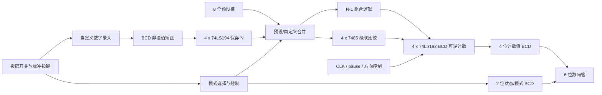

# 可变模计数器：项目理解与项目基线

> 文档性质：现有典例的阅读结果，不是新方案或最终验收报告。  
> 分析日期：2026-07-19  
> 分析对象：`counter_v4` Quartus 工程与《夏季硬件大作业设计报告 4.0》

快速入口：[工程文件](../counter_v4/counter_v4.qpf) | [顶层原理图](../counter_v4/counter_v4.bdf) | [仿真波形](../counter_v4/counter_v4.vwf) | [PDF 报告](../report/夏季硬件大作业设计报告4.0.pdf) | [DOCX 报告](../report/夏季硬件大作业设计报告4.0.docx)

## 1. 一句话结论

这是一个基于 Quartus II 原理图和传统 74 系列逻辑器件的可变模 BCD 计数器：用户可选择 8 个预设模或录入 1~9999 范围内的自定义模，并在六位数码管上查看状态和四位十进制计数值。

典例已有完整的原理图、功能仿真、编译产物和实验箱调试记录，适合用作“需求和行为参考”。但它存在明确的时序失败、时钟门控、引脚约束不完整和按键抖动问题，不应直接当作新项目的底层架构。

## 2. 题目要求的产品化拆解

| 需求 | 对用户可见的含义 | 典例的实现方式 |
| --- | --- | --- |
| 六位数码管 | 2 位显示工作状态/模式，4 位显示计数值 | 每位输出 4 bit 8421 BCD，总计 24 路数据输出 |
| 任意设定模 | 用户输入一个四位十进制数 N | 用 4 bit 拨码开关逐位输入，`enter` 确认并切换位置 |
| 暂停/继续 | 保留当前值，暂停后从原值继续 | `pause=1` 暂停，`pause=0` 继续 |
| 倒计时 | 按 N-1 到 0 循环计数 | `U_D_switch=1` 倒数，`0` 正数 |
| 8 个常见模 | 不需录入 N，直接选择 | `d=0` 后用 `cba` 三位编码选择 |
| 独立模式 | 预设值之间互不依赖 | 组合逻辑产生各模的四位 BCD 上限 |

“模 N 计数”在本项目中表示数列只包含 `0 ... N-1`。例如模 12 正数为 `0000 ... 0011` 后回到 `0000`，即十进制的 `0 ... 11` 循环。

## 3. 用户能看到的产品骨架

```text
输入区
├─ 时钟：CLK
├─ 运行控制：pause、U_D_switch
├─ 模式选择：d、c、b、a
└─ 自定义录入：i4、i3、i2、i1、enter

处理区
├─ 预设模选择
├─ 自定义模逐位保存与输入纠错
├─ N-1 计算
├─ 四位 BCD 正/倒计数
└─ 越界检测与回绕

显示区
├─ 第 1 位：运行状态
├─ 第 2 位：预设模序号/自定义标记/当前录入位
└─ 后 4 位：千、百、十、个的 BCD 计数值
```

## 4. 操作流程

### 4.1 预设模式

1. 设置 `d=0`。
2. 用 `cba` 选择模 8、10、12、16、24、30、365 或 1024。
3. 设置 `U_D_switch=0` 正数，或 `1` 倒数。
4. 设置 `pause=0`，每个 `CLK` 有效边沿更新一次计数。
5. 将 `pause` 置 `1` 暂停，再置 `0` 时从原数继续。

### 4.2 自定义模式

1. 设置 `d=1`，并用 `pause=1` 停在录入状态。
2. 通过 `i4 i3 i2 i1` 给出当前十进制位的 8421 BCD 值。
3. 给 `enter` 一个稳定的高电平脉冲，确认当前位并进入下一位。
4. 录入顺序为个位、十位、百位、千位；第二位数码管以 `0~3` 提示当前位置。
5. 输入某位大于 9 时，典例会自动改成 9。
6. 录入完成后将 `pause=0` 开始计数。

报告中的典型用例是模 19：先输入 `1110`（十进制 14），电路把非法的个位矫正为 9；再输入 `0001` 作为十位，最终得到 N=19。

## 5. 六位数码管的显示协议

工程不是直接输出段码，而是向实验箱每位数码管输出 4 bit 8421 BCD。因此 6 位数码管对应 `6 x 4 = 24` 个数据引脚。

| 显示位 | 工程分组 | 输出线 | 含义 |
| --- | --- | --- | --- |
| 第 1 位（最左） | `O_5` | `o24..o21` | 状态：0 正数，1 倒数，2 暂停，3 自定义录入 |
| 第 2 位 | `O_4` | `o20..o17` | 预设模编号 0~7；自定义计数时显示 8；录入时显示位置 0~3 |
| 第 3 位 | `O_3` | `o16..o13` | 千位 |
| 第 4 位 | `O_2` | `o12..o9` | 百位 |
| 第 5 位 | `O_1` | `o8..o5` | 十位 |
| 第 6 位（最右） | `O_0` | `o4..o1` | 个位 |

报告某处写“第二位显示 0~4”，但操作说明和仿真实例都是 `0~3` 分别表示个、十、百、千位。本 README 以后者为准。

## 6. 八个预设模

| `cba` | 第 2 位显示 | 模 N | 正数序列 |
| --- | ---: | ---: | --- |
| `000` | 0 | 8 | 0~7 |
| `001` | 1 | 10 | 0~9 |
| `010` | 2 | 12 | 0~11 |
| `011` | 3 | 16 | 0~15 |
| `100` | 4 | 24 | 0~23 |
| `101` | 5 | 30 | 0~29 |
| `110` | 6 | 365 | 0~364 |
| `111` | 7 | 1024 | 0~1023 |

模 12 仿真使用 `cba=010`，报告将它称为“模式 3”，但第二位数码管实际显示 2。这是“人类第 3 项”与“从 0 开始的编码 2”的口径差异。

## 7. 系统逻辑架构



### 7.1 核心器件与作用

| 器件 | 原理图数量 | 实际职责 |
| --- | ---: | --- |
| 74LS192 | 5 | 4 片组成四位十进制可逆计数器；1 片用于输入位置控制 |
| 74LS194 | 4 | 分别保存自定义模 N 的四个 BCD 数字 |
| 74LS85/7485 | 5 | 4 片级联比较当前计数值与 N；1 片用于输入值大于 9 的检测 |
| 74LS138 | 2 | 预设模选择、自定义录入位选择/寄存器屏蔽 |
| 与/或/非等门 | 大量 | 模值生成、清零/置数、N-1、显示状态和时钟控制 |

整张 `.bdf` 共包含 268 个图形化器件，其中 87 个 `AND2`、63 个 `OR2`、38 个 `NOT`。这说明典例是“单张大原理图 + 大量门级组合逻辑”，而非分层 HDL 工程。

### 7.2 正数回绕

74LS192 本身是十进制 BCD 计数器，四片级联得到 `0000~9999`。正数时，7485 比较器检测当前值是否到达 N；到达后触发清零，形成 `0~N-1` 循环。

### 7.3 倒数回绕和 N-1

倒数不能直接在下溢后加载 N，否则会多出一个数。典例先用组合逻辑计算 N-1，再在计数值由 0 下溢成 9999 时装载 N-1，形成 `N-1~0` 循环。

报告说明早期版本直接用 74LS192 的借位输出 BON 判断下溢，导致数字 0 的显示周期只有其他数字的一半。最终版改为直接检测四位输出 `9999`后加载 N-1。

### 7.4 暂停和自定义录入

- `pause` 与时钟组合后决定计数器是否获得有效边沿。
- `enter` 被当作时钟使用，推动录入位置状态并使对应 74LS194 保存数据。
- 74LS138 只允许当前被选中的一位寄存器更新。
- 7485 不负责“保存模值”；报告这个表述不准确。实际保存由 74LS194 完成，7485 只负责比较。

## 8. 典例的版本演进

报告记录了 4 个版本的演进路线：

1. 先完成固定的模 8 计数器，验证基本计数骨架。
2. 增加 8 个预设模。
3. 增加自定义模和十进制逐位输入。
4. 增加非法 BCD 输入自动矫正，并修正倒数时的显示周期问题。

设计也从最初的“74LS193 + 十六进制输出”改为“74LS192 + 十进制 BCD 输出”，原因是实验箱数码管直接接收 8421 BCD。

## 9. 项目文件地图

```text
9_可变模计数器/
├─ counter_v4/
│  ├─ counter_v4.qpf          Quartus 项目入口
│  ├─ counter_v4.qsf          器件、顶层文件和部分引脚约束
│  ├─ counter_v4.bdf          顶层原理图，也是主要源码
│  ├─ counter_v4.vwf          1 us 功能仿真激励与波形
│  ├─ counter_v4.sof/.pof     已生成的编程文件
│  ├─ counter_v4.pin          编译后完整引脚报告
│  ├─ *.map/*.fit/*.tan.rpt   综合、布线和时序报告
│  ├─ counter_v4.sim.rpt      功能仿真报告
│  └─ db/                     Quartus 生成的编译数据库/缓存
├─ report/
│  ├─ 夏季硬件大作业设计报告4.0.docx
│  └─ 夏季硬件大作业设计报告4.0.pdf
└─ output/
   └─ README.md                 本分析文档
```

## 10. 现有工程的可复现信息

| 项目 | 值 |
| --- | --- |
| Quartus 版本 | Quartus II 6.0 SP1，Build 202，2006-06-20 |
| FPGA 家族 | ACEX1K |
| 目标器件 | `EP1K30TC144-1` |
| 顶层实体 | `counter_v4` |
| 主源文件 | `counter_v4.bdf` |
| 编译结果 | Successful，2023-07-02 20:28:14 |
| 逻辑单元 | 201 / 1728（12%） |
| 引脚 | 57 / 102（56%） |
| 存储器 | 0 bit |
| 功能仿真 | 0~1 us，496 节点，1357 次跳变 |
| 仿真覆盖率 | 31.85% |
| 时序结果 | `Met timing requirements: No`，共 95 条失败路径 |

### 10.1 打开与检查

1. 安装能支持 ACEX1K/EP1K30 的旧版 Quartus II；典例原环境为 6.0 SP1。
2. 打开 `counter_v4/counter_v4.qpf`。
3. 在 Block Diagram/Schematic Editor 中打开 `counter_v4.bdf`。
4. 执行完整编译，对照 `counter_v4.flow.rpt`、`counter_v4.fit.rpt` 和 `counter_v4.tan.rpt`。
5. 打开 `counter_v4.vwf`，以 Functional Simulation 运行 1 us。
6. 下载前必须根据当前实验箱重新核对所有引脚，不能只依赖现有 `.sof/.pof`。

注：新版 Quartus Prime 往往不再支持 ACEX1K。若要迁移到新 FPGA，应先重写/重构逻辑，而不是期望原 `.bdf` 无修改直接编译。

## 11. 已有验证证据

### 11.1 功能仿真

现有 `counter_v4.vwf` 主要是一个组合场景：

- `d=1`，进入自定义模式。
- 先录入 `1110`，验证非法 BCD 值被改为 9。
- 再录入 `0001`，得到模 19。
- 前 150 ns 使 `pause=1`，之后释放暂停。
- `U_D_switch` 在 600 ns 由 0 变 1，观察正数转倒数。
- `CLK` 主要使用 20 ns 周期。

报告另外给出了模 12、暂停/继续和倒数的波形截图。仿真器报告为 0 错误、0 警告，但这只是功能仿真，且覆盖率仅 31.85%，不等于全量功能已被自动验证。

### 11.2 实验箱调试

报告声称已在 DICE-SEM II 实验箱上验证：

- 8、10、12、16、24、30、365、1024 八个预设模可正常计数。
- 暂停、继续和倒数可正常执行。
- 自定义输入经过按键/脉冲和第四位引脚调整后成功。

这部分是报告的人工测试结论，项目中没有为八个预设模分别保留可自动重放的测试向量。

## 12. 不能忽略的问题和风险

| 级别 | 问题 | 证据 | 对新项目的影响 |
| --- | --- | --- | --- |
| 高 | 时序未通过 | Flow Summary 明确显示 `Met timing requirements: No`；Timing Analyzer 报告 95 条失败路径 | 低速人工操作可能正常，但不具备可靠的 FPGA 时序保证 |
| 高 | 组合逻辑门控/派生时钟 | 分析器将 `pause`、`enter`、`U_D_switch` 也识别为时钟，并警告 64 个潜在的纹波/门控时钟节点 | 容易出现时钟偏斜、毛刺和偶发错计数 |
| 高 | 按键没有稳健的消抖和单脉冲整形 | 报告记录 `enter` 用普通开关模拟时会令多位同时置入 | 实际按一次可能被识别为多次 |
| 高 | 引脚约束不完整 | 顶层共 57 个引脚，`.qsf` 只显式约束 35 个；`CLK`、`LD`、`OE*`、`t*` 等依赖自动分配 | 重新编译后引脚可变，下载与接线不可盲信 |
| 中 | 仿真不充分 | 功能仿真覆盖率 31.85%，没有自动输出比对，设置/保持和毛刺检测关闭 | 无法仅凭当前 `.vwf` 证明所有模和边界条件 |
| 中 | 自定义模边界不清晰 | 报告声称 N 可为 0~9999，但“模 0”无数学意义，也没有边界测试 | 新版应明确限制 N 为 1~9999，并定义 N=1 的行为 |
| 中 | 源码是巨型单页 BDF | 478 KB 原理图、268 个器件、大量门级连线 | 修改、评审、复用和版本差异对比都很困难 |
| 低 | 综合警告未清理 | 23 个综合警告，包含若干未连接端口；`o24` 被优化为常 0 | 部分是未使用端口的预期结果，但会掩盖真实警告 |

对典例的准确定位是：**功能思路成立、低速实验原型有运行记录，但不是时序收敛、可直接量产或无条件复现的设计。**

## 13. 建议的后续验收基线

新项目不应只测“会跳数”，至少需要以下可重放用例：

| 类别 | 最小验收用例 | 通过标准 |
| --- | --- | --- |
| 八个预设模 | 分别运行模 8、10、12、16、24、30、365、1024 | 正数在 N-1 后回 0，倒数在 0 后回 N-1 |
| 暂停/继续 | 任意数值暂停若干时钟后恢复 | 暂停期间数值不变，恢复后只更新一次/时钟 |
| 方向切换 | 运行中正数切倒数再切回 | 不丢数、不多跳、不出现非法 BCD |
| 自定义典型值 | N=19、365、1024、9999 | 显示和回绕边界正确 |
| 自定义边界 | N=1、9、10、9999，并尝试 0000 | 边界行为与需求明确一致，0000 被拒绝或安全处理 |
| 非法单位输入 | 1010~1111 | 按规格拒绝、报错或钳位为 9 |
| 真实按键 | 快速按、长按、抖动、同时按 | 每次有效操作只生成一个事件 |
| 复位/上电 | 多次重新上电 | 状态、模式和计数值有确定初值 |
| 时序 | 使用目标时钟频率执行时序分析 | 0 失败路径，无未约束主要时钟 |

## 14. 后续设计时可继承与不应继承的内容

### 可继承

- 六位显示的信息分层：1 位状态 + 1 位模式/位置 + 4 位计数值。
- 预设模和自定义模两条用户路径。
- 自定义数字逐位录入、显示当前录入位的交互。
- 模 N 正数 `0~N-1` 和倒数 `N-1~0` 的明确回绕语义。
- 非法 BCD 输入需要被阻止或矫正的防御性思路。

### 不应原样继承

- 不要用与门直接截断时钟；应使用单一全局时钟和 clock enable。
- 不要把 `pause`、`enter`、`U_D_switch` 当时钟；应先同步、消抖并转换为单周期事件。
- 不要继续扩张单页门级 BDF；应把模式管理、计数核心、按键处理和显示分成可独立测试的模块。
- 不要依赖 Fitter 自动选引脚；所有板级 I/O 都应显式约束。
- 不要只保留截图式验证；应有自检查 testbench 和可重复的验收矩阵。

## 15. 当前理解边界

本轮只阅读和分析了学长典例，未修改电路、引脚、仿真激励或编程文件。目前可以确定“产品应该做什么”和“典例如何实现”，但在正式开发新版前，还需要确认目标 FPGA/实验箱型号、系统时钟频率、数码管接口类型、按键电平和上电默认状态。
